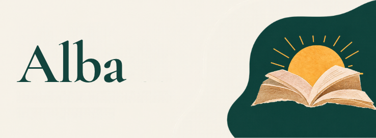
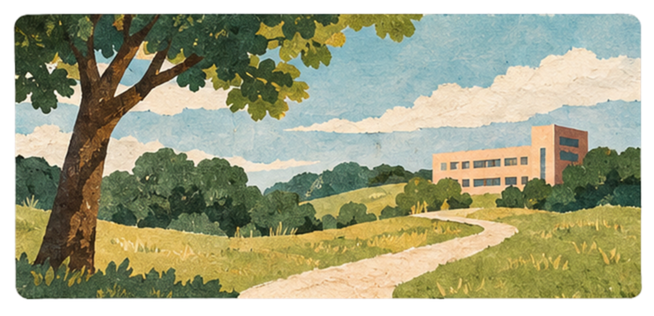

<p align="center">
  <a href="https://alba-hub.vercel.app">
    
  </a>
</p>

<p align="center">
  <a href="https://alba-hub.vercel.app">Acessar a Alba</a> ·
  <a href="#um-semestre-com-mais-possibilidades">Conheça a Alba</a> ·
  <a href="#para-rodar-por-aí">Rodar localmente</a> ·
  <a href="CONTRIBUTING.md">Contribuir</a> ·
  <a href="THIRD_PARTY_NOTICES.md">Licenças e créditos</a>
</p>

## Um semestre com mais possibilidades

A Alba reúne benefícios digitais para estudantes brasileiros em um catálogo gratuito, independente e aberto à colaboração. Um lugar para descobrir ferramentas, entender quem pode usar e encontrar o caminho oficial para solicitar cada oferta. Explore em **[alba-hub.vercel.app](https://alba-hub.vercel.app)**.

**De estudantes para estudantes.** Sem cobrança para explorar, sem matrícula enviada à Alba e sem conta obrigatória. A aprovação e a contratação acontecem com cada fornecedor.

<p align="center">
  
</p>

### Encontre. Entenda. Guarde.

| No catálogo | Na sua rotina |
| --- | --- |
| Busca por serviço e plano | Editorias de Estudo, Criatividade e Bem-estar |
| Filtros de gratuidade, teste e preço estudantil | Um ponto de partida conforme seus interesses |
| Requisitos, duração, renovação e fontes oficiais | Favoritos guardados neste navegador |
| Data de conferência e prazos de resgate | Acesso pelo celular e pelo computador |

A experiência usa papel creme, verde profundo, títulos em Fraunces, ilustrações editoriais e movimentos suaves. O sol e o livro acompanham as transições; os detalhes continuam no conteúdo.

## O que já está por aqui

**12 serviços · 15 opções de acesso individual · Brasil**

GitHub, Google, Notion, Canva, Spotify, Apple Music, Microsoft, Autodesk, Adobe, YouTube, JetBrains e Figma.

As ofertas incluem licenças gratuitas, assinaturas com preço estudantil e testes. O teste do Canva Pro é identificado como **promoção geral**, acessível também a universitários elegíveis. Não é apresentado como desconto exclusivo para estudantes.

Preços e condições mudam. Cada plano mantém sua própria data de verificação; a revisão mais recente é de **22/11/2026**. Consulte as [fontes do catálogo](docs/catalog-sources.md) e confirme a oferta no fornecedor. A versão para os EUA está em [planejamento](docs/expansao-eua.md).

> **Em construção, com cuidado.** O catálogo funciona sem conta. O cadastro opcional já tem integração com Supabase Auth, mas ainda há validações de e-mail e privacidade para o lançamento. Favoritos continuam locais, sem sincronização. Veja o [estado do projeto](docs/project_state.md).

## Para rodar por aí

Use **Node.js 24** e npm, na raiz do repositório:

```sh
npm ci
cp public/app-config.example.json public/app-config.json
npm run dev
```

No PowerShell, use `Copy-Item public/app-config.example.json public/app-config.json` no lugar de `cp`, se preferir. O exemplo deixa a instância sem conexão com contas; você já pode explorar o catálogo inteiro.

```sh
npm run build
npm test
npm run preview
```

Configuração de uma instância própria, estrutura do projeto e alternativa para o workspace Windows restrito estão em [Desenvolvimento](docs/development.md). O arquivo real `app-config.json` fica fora do Git. Nunca publique segredos do banco no cliente.

## Um projeto para construir em aberto

Encontrou uma oferta, uma condição que mudou ou algo que poderia ficar mais acessível? Conte para a gente em uma issue ou prepare um pull request. As informações precisam de fontes oficiais, análise regional e revisão antes de entrar no catálogo.

Leia [Como contribuir](CONTRIBUTING.md) e o [protocolo de validação](docs/research/protocolo-validacao.md). A pesquisa aprofundada do [Figma Education no Brasil](docs/research/figma-education.md) mostra o cuidado esperado com elegibilidade, duração e divergências entre fontes.

Mudanças substanciais são avaliadas em fork local antes de integrar o Main. **Este repositório contém somente o Main; as pastas de fork e backups não são publicadas.**

## Código aberto, créditos preservados

O código original da Alba é distribuído sob a [licença MIT](LICENSE). Fontes, ícones e bibliotecas mantêm suas licenças e avisos. Marcas, identidade visual e ilustrações têm escopo separado e não estão cobertas pela licença do código: confira [Licenças e créditos](THIRD_PARTY_NOTICES.md) antes de reutilizá-las.

<p align="center">
  <sub>Alba · Boas descobertas para a vida estudantil.</sub>
</p>
